# Cinecturlink 2 : guide d'utilisation

_Cinecturlink 2_ est un plugin pour [Dotclear](https://dotclear.org) qui permet de présenter les livres, films,
musiques, sites web… que vous aimez. Chaque élément est un **lien** : un titre, un auteur, une image et une
évaluation. Les liens sont rangés dans des **catégories**.

Les liens sont affichés sur le blog par des widgets et par une page publique dédiée.

* [Installation et permissions](#installation-et-permissions)
* [Les réglages du blog](#les-réglages-du-blog)
* [Les catégories](#les-catégories)
* [Les liens](#les-liens)
* [Filtrer et trier les liens](#filtrer-et-trier-les-liens)
* [Agir sur plusieurs liens](#agir-sur-plusieurs-liens)
* [Les widgets](#les-widgets)
* [La page publique](#la-page-publique)
* [Le tableau de bord](#le-tableau-de-bord)
* [Autres plugins](#autres-plugins)
* [Désinstallation](#désinstallation)

## Installation et permissions

Le plugin demande Dotclear 2.39 et PHP 8.1 ou plus récent. Installez-le comme n'importe quel plugin, depuis la
page _Plugins_ de l'administration.

Le plugin crée ses propres tables dans la base de données, une pour les liens et une pour les catégories.

Il faut être **administrateur** du blog pour modifier les réglages du plugin, et avoir la permission
**« gérer tout le contenu »** (_content admin_) pour gérer les liens et les catégories.

Une fois installé, le plugin apparaît dans le menu _Plugins_, sous le nom **Cinecturlink 2**.

## Les réglages du blog

Les réglages se trouvent dans _Blog › Paramètres du blog_, dans la section **Paramètres des plugins pour ce blog**,
sous le titre _Cinecturlink 2_. Chaque blog a ses propres réglages.

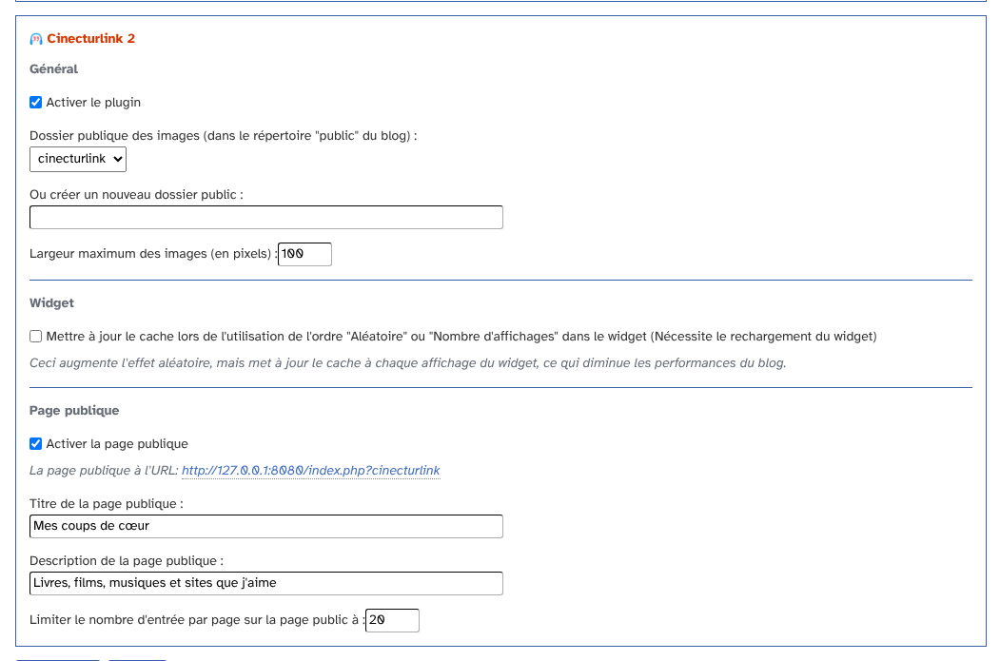

**Général**

* **Activer le plugin** : tant que cette case n'est pas cochée, les widgets et la page publique ne s'affichent pas.
* **Dossier publique des images** : le dossier, dans le répertoire _public_ du blog, où sont rangées les images
  des liens. Le dossier _cinecturlink_ est proposé par défaut.
* **Ou créer un nouveau dossier public** : saisissez un nom pour que le plugin crée un nouveau dossier. Il est
  alors utilisé à la place du dossier choisi dans la liste.
* **Largeur maximum des images** : largeur d'affichage des images dans les widgets, en pixels (entre 10 et 512).

**Widget**

* **Mettre à jour le cache lors de l'utilisation de l'ordre « Aléatoire » ou « Nombre d'affichages »** : à
  cocher pour que le tirage change plus souvent. Le cache du blog est alors mis à jour à chaque affichage
  du widget, ce qui ralentit le blog. Après avoir changé cette option, enregistrez à nouveau les widgets.

**Page publique**

* **Activer la page publique** : affiche tous les liens sur une page du blog. L'adresse de cette page est
  indiquée sous la case.
* **Titre de la page publique** et **Description de la page publique** : textes affichés en haut de la page.
* **Limiter le nombre d'entrée par page sur la page public à** : nombre de liens par page (10 si le champ
  est vide).

## Les catégories

Le bouton **Gérer les catégories**, en haut de la liste des liens, ouvre la page des catégories.

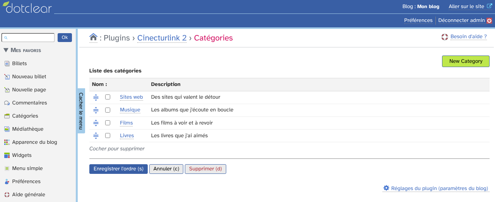

* Le bouton vert en haut à droite ajoute une catégorie.
* Le nom de la catégorie mène à sa page de modification.
* Pour changer l'ordre des catégories, glissez-les avec la poignée de la première colonne, puis cliquez sur
  **Enregistrer l'ordre**. Si le glisser-déposer est désactivé dans vos préférences, des champs numériques
  permettent de saisir la position de chaque catégorie.
* Pour supprimer des catégories, cochez-les puis cliquez sur **Supprimer**.

Une catégorie a un **titre** et une **description**, de 64 caractères au plus. Les deux sont obligatoires, et
deux catégories ne peuvent pas avoir le même titre.

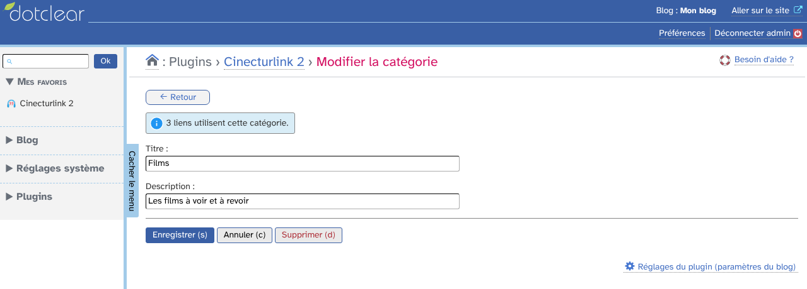

Sur la page d'une catégorie existante, un message indique combien de liens l'utilisent. Supprimer une catégorie
ne supprime pas ses liens : ils restent dans la liste, sans catégorie.

## Les liens

La page du plugin affiche la liste des liens, les derniers modifiés en premier.

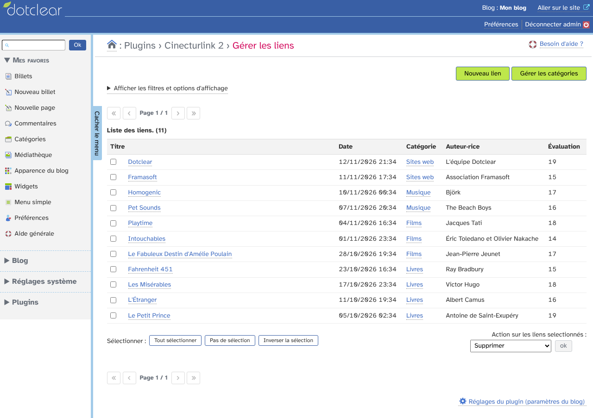

* Le titre d'un lien mène à sa page de modification, le nom de sa catégorie à la page de cette catégorie.
* Le bouton vert **Nouveau lien** ouvre le formulaire d'ajout.
* Le bouton vert **Gérer les catégories** ouvre la page des catégories.

### Ajouter un lien

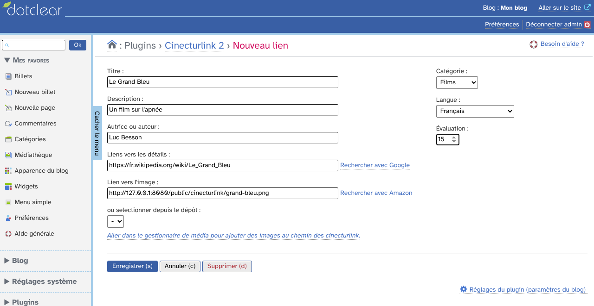

* **Titre** (obligatoire) : le nom de l'œuvre ou du site. Deux liens ne peuvent pas avoir le même titre.
* **Description** : une phrase pour présenter le lien.
* **Autrice ou auteur** (obligatoire).
* **Liens vers les détails** : l'adresse d'une page qui présente l'œuvre, par exemple sur Wikipédia. Le lien
  **Rechercher avec Google** ouvre une fenêtre pour la chercher.
* **Lien vers l'image** : l'adresse d'une image, par exemple une couverture. Le lien **Rechercher avec Amazon**
  ouvre une fenêtre pour la chercher.
* **Ou sélectionner depuis le dépôt** : liste les images du dossier public du plugin envoyées par la
  médiathèque de Dotclear, classées par titre. Le lien en dessous mène à la médiathèque pour en ajouter.
* **Catégorie**, **Langue** et **Évaluation** : l'évaluation est une note de 0 à 20. Elle vaut 10 si le champ
  est vide.

Cliquez sur **Enregistrer** pour créer le lien.

### Modifier ou supprimer un lien

Un clic sur le titre d'un lien ouvre sa page.

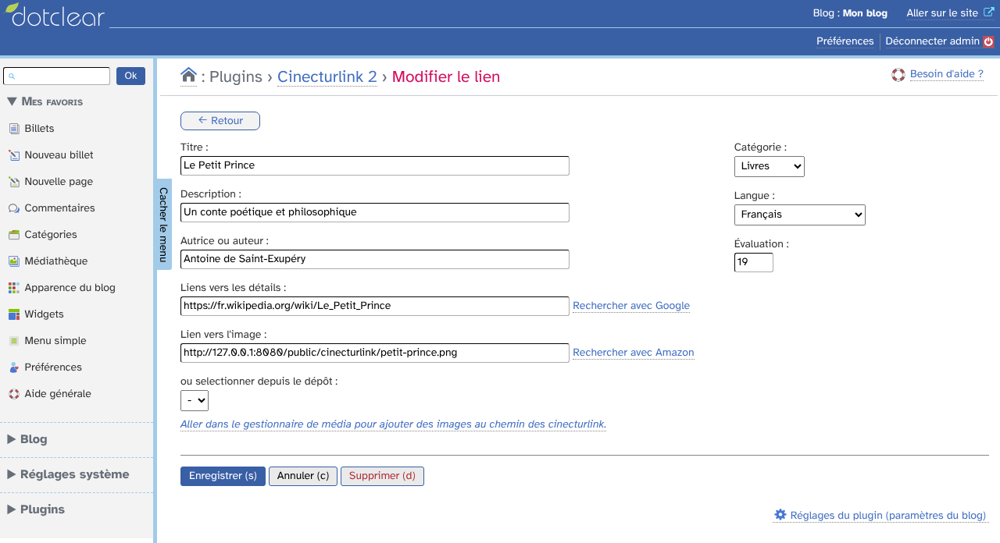

Modifiez les champs puis cliquez sur **Enregistrer**. Le bouton **Supprimer** efface le lien. Il n'y a pas de
corbeille : la suppression est définitive. Le bouton **Annuler** revient à la liste sans rien changer.

## Filtrer et trier les liens

Le lien **Afficher les filtres et options d'affichage**, en haut de la liste, déplie le même bloc que les autres
listes de Dotclear (billets, commentaires…).

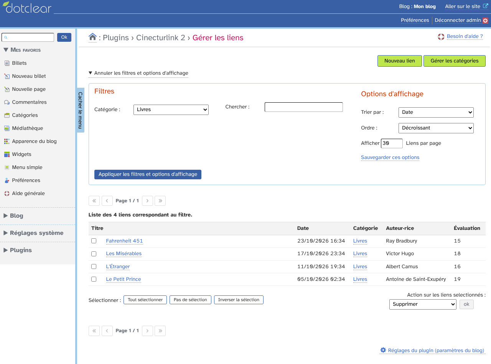

Filtres :

* **Catégorie** : n'affiche que les liens d'une catégorie.
* **Chercher** : un ou plusieurs mots, cherchés dans les titres des liens. Tous les mots doivent y figurer.

Options d'affichage :

* **Trier par** : date, titre, catégorie, auteur, description, lien ou évaluation, dans l'ordre croissant
  ou décroissant.
* **Afficher _n_ liens par page** : 30 par défaut.

Le lien **Sauvegarder ces options** garde le tri et le nombre de liens par page pour vos prochaines visites. Ils
peuvent aussi être réglés dans vos préférences, onglet _Mes options_, rubrique **Options des listes**.

### Choisir les colonnes

Les colonnes de la liste se choisissent dans _Préférences › Mes options_, rubrique **Colonnes optionnelles
affichées dans les listes**, dans le bloc _Cinecturlink 2_.

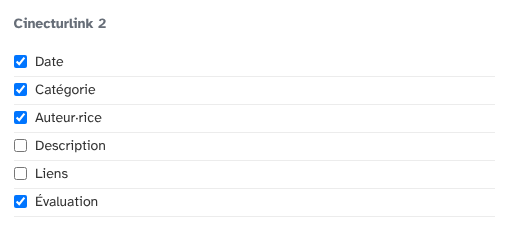

Cochez les colonnes à afficher : _Date_, _Catégorie_, _Auteur·rice_, _Description_, _Liens_ et _Évaluation_.
Ce choix est personnel : il ne change rien pour les autres utilisatrices et utilisateurs du blog.

## Agir sur plusieurs liens

Cochez des liens, puis choisissez une action en bas de la liste, sous **Action sur les liens selectionnés** :

* **Supprimer**,
* **Changer l'évaluation**,
* **Changer la catégorie**.

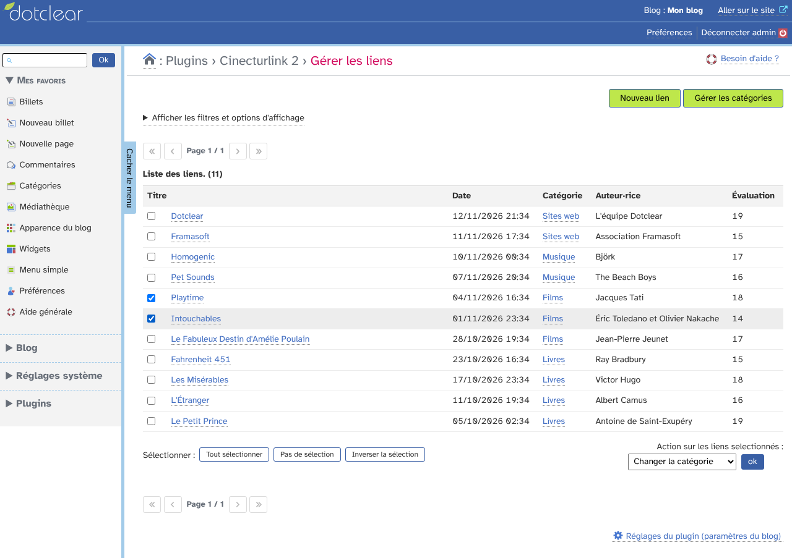

Les boutons _Tout sélectionner_, _Pas de sélection_ et _Inverser la sélection_ aident à cocher les liens.

Pour changer l'évaluation ou la catégorie, une page demande la nouvelle valeur pour tous les liens choisis.
Cliquez sur **Enregistrer** pour l'appliquer.

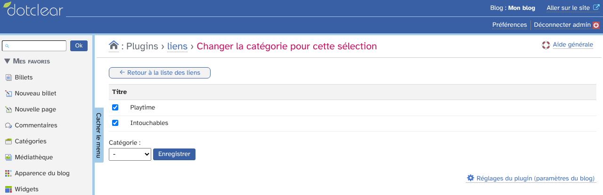

## Les widgets

Le plugin ajoute deux widgets, à placer dans _Apparence du blog › Widgets_. Les widgets ne s'affichent que si
le plugin est activé dans les réglages du blog.

### Mes cinecturlink

Ce widget affiche une sélection de liens avec leur image.

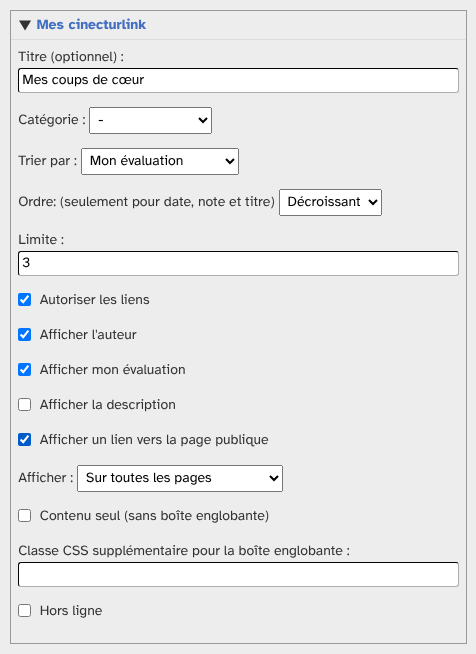

* **Titre** : le titre du widget.
* **Catégorie** : une catégorie, ou les liens sans catégorie. Sans choix, tous les liens sont concernés.
* **Trier par** : _Date de mise à jour_, _Mon évaluation_, _Titre_, _Aléatoire_ ou _Nombre d'affichages_. Avec
  _Nombre d'affichages_, les liens les moins montrés passent en premier.
* **Ordre** : croissant ou décroissant. Il ne s'applique qu'aux tris par date, évaluation ou titre.
* **Limite** : le nombre de liens affichés.
* **Autoriser les liens** : le titre et l'image mènent à l'adresse saisie dans _Liens vers les détails_.
* **Afficher l'auteur**, **Afficher mon évaluation** (sur 20) et **Afficher la description**.
* **Afficher un lien vers la page publique** : ajoute un lien « Plus de liens » sous le widget. La page publique
  doit être activée.

Les autres options (_Afficher_, _Contenu seul_, _Classe CSS_, _Hors ligne_) sont celles de tous les widgets
de Dotclear.

### Liste des catégories de cinecturlink

Ce widget affiche la liste des catégories, chacune menant à la page publique de la catégorie. Il n'apparaît que
si la page publique est activée.

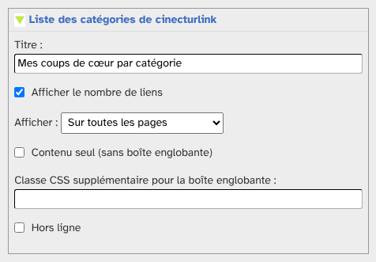

* **Titre** : le titre du widget.
* **Afficher le nombre de liens** : ajoute entre parenthèses le nombre de liens de chaque catégorie.

### Sur le blog

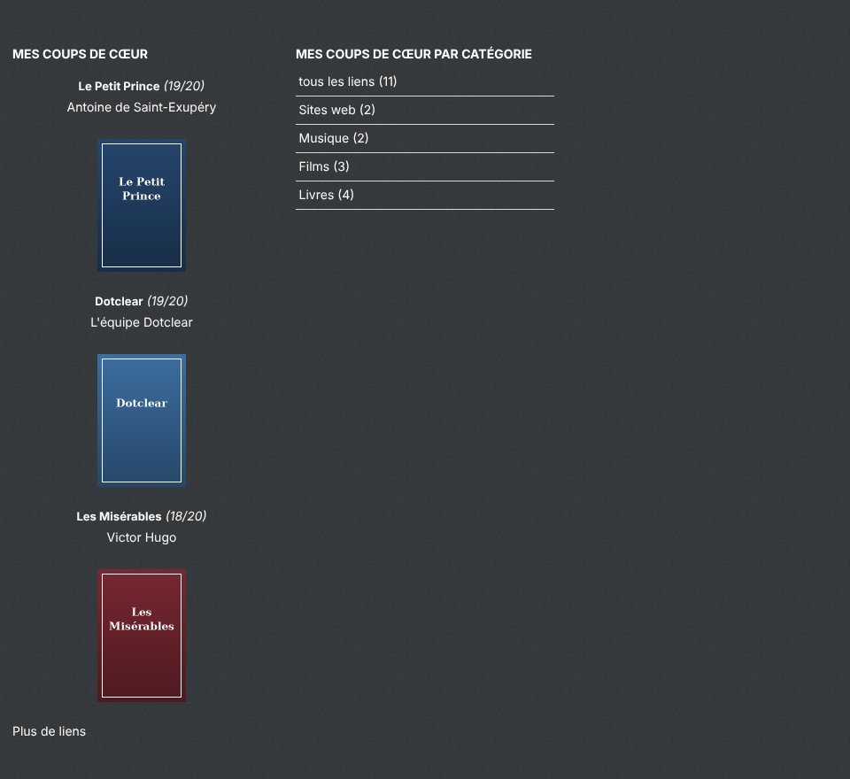

## La page publique

Quand la page publique est activée, tous les liens sont affichés sur une page du blog, à l'adresse indiquée dans
les réglages du plugin. Avec les adresses de type _path info_, c'est l'adresse du blog suivie de `/cinecturlink`.

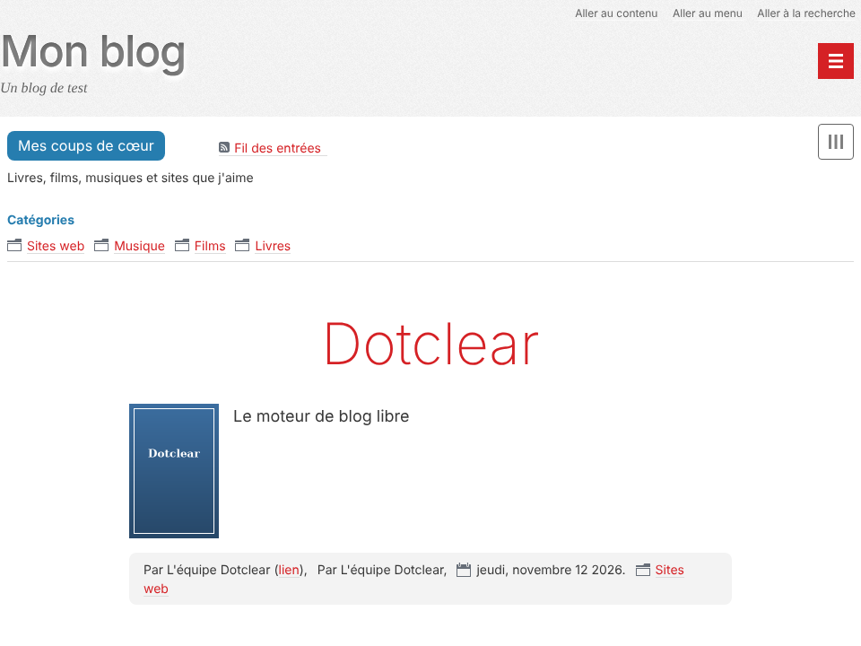

* Sous le titre et la description, la liste des catégories mène à une page par catégorie
  (`/cinecturlink/c2cat/` suivi du titre de la catégorie).
* Chaque lien est présenté avec son image, sa description, son auteur, sa date de création et sa catégorie.
* Les liens sont répartis en pages de la taille choisie dans les réglages, avec des liens vers les pages
  précédente et suivante.
* Le lien **Fil des entrées** mène aux flux Atom (`/cinecturlink/feed/atom`) et RSS (`/cinecturlink/feed/rss2`).

### Changer l'apparence

La page utilise des modèles fournis avec le plugin, adaptés au thème par défaut de Dotclear : ils sont dans le
dossier `default-templates` du plugin, avec un sous-dossier par jeu de modèles (`dotty`, `mustek`).

Pour les adapter à votre thème, copiez les fichiers `cinecturlink2.html`, `cinecturlink2-atom.xml` et
`cinecturlink2-rss2.xml` dans le dossier `tpl` de votre thème, puis modifiez-les. Les balises du plugin
commencent par `c2` (par exemple `c2Entries` pour la boucle des liens).

## Le tableau de bord

Le plugin propose un favori qui mène à la liste des liens, utile pour y accéder depuis le tableau de bord.
Chaque personne l'ajoute pour elle-même, dans ses **Préférences**, onglet _Mon tableau de bord_.

Dans _Autres favoris disponibles_, cochez **Cinecturlink 2**, puis cliquez sur _Ajouter à mes favoris_.

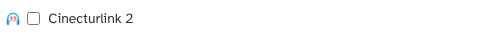

Le favori apparaît dans le menu et sous forme d'icône sur le tableau de bord.

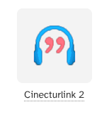

Il est réservé aux personnes ayant la permission de gérer tout le contenu du blog.

## Autres plugins

* Avec le plugin _Sitemaps_, la page publique et les pages de catégories peuvent être ajoutées au plan du site,
  dans les réglages de _Sitemaps_, sous le nom _Cinecturlink 2_.
* Avec le plugin _Activity report_, la création, la mise à jour et la suppression d'un lien peuvent être ajoutées
  au rapport d'activité du blog.

Aucun de ces deux plugins n'est nécessaire.

## Désinstallation

Avec le plugin _Uninstaller_ de Dotclear, la désinstallation propose de supprimer les réglages du plugin, les
tables des liens et des catégories, et le plugin lui-même.

Le dossier public des images n'est pas supprimé : effacez-le vous-même si vous n'en avez plus besoin.
